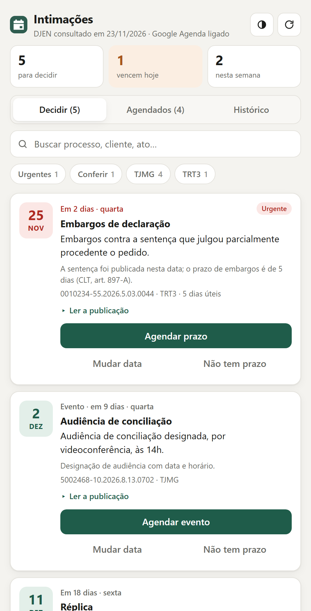
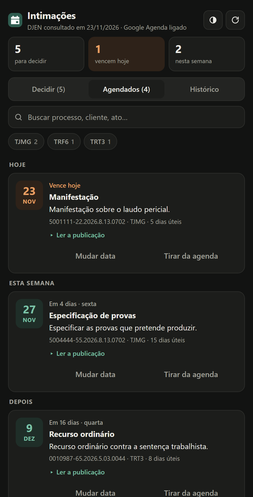
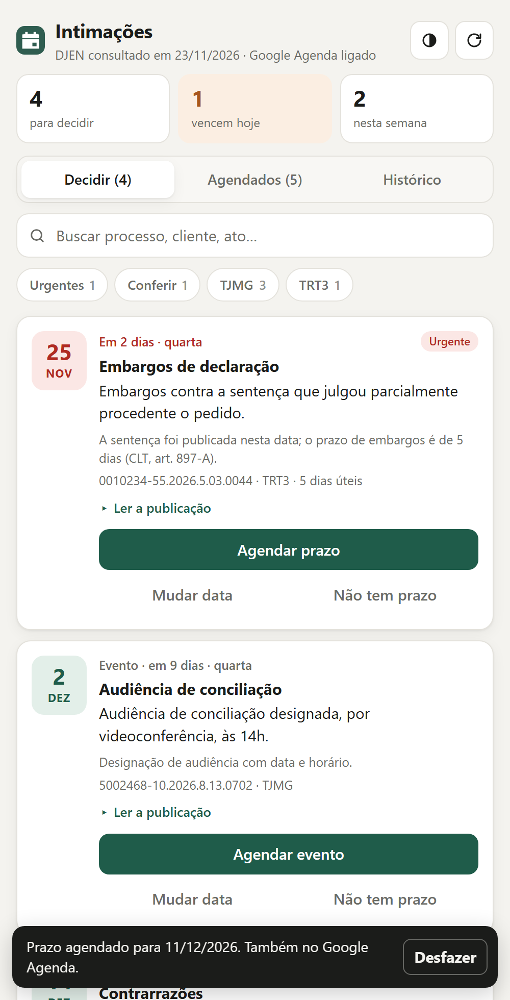
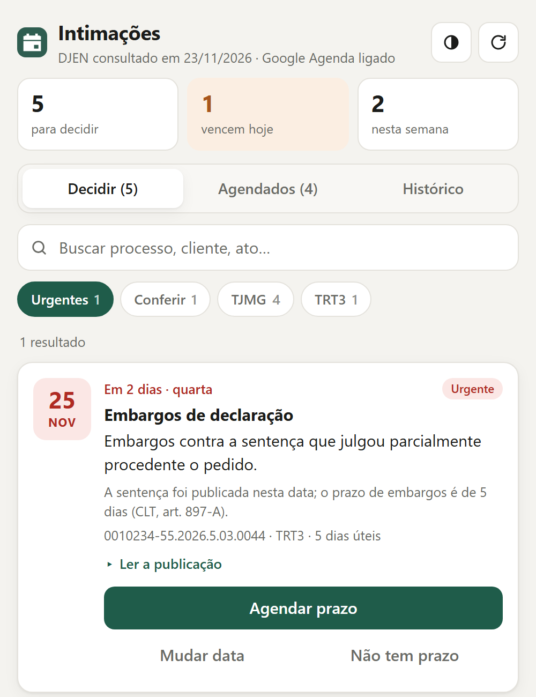
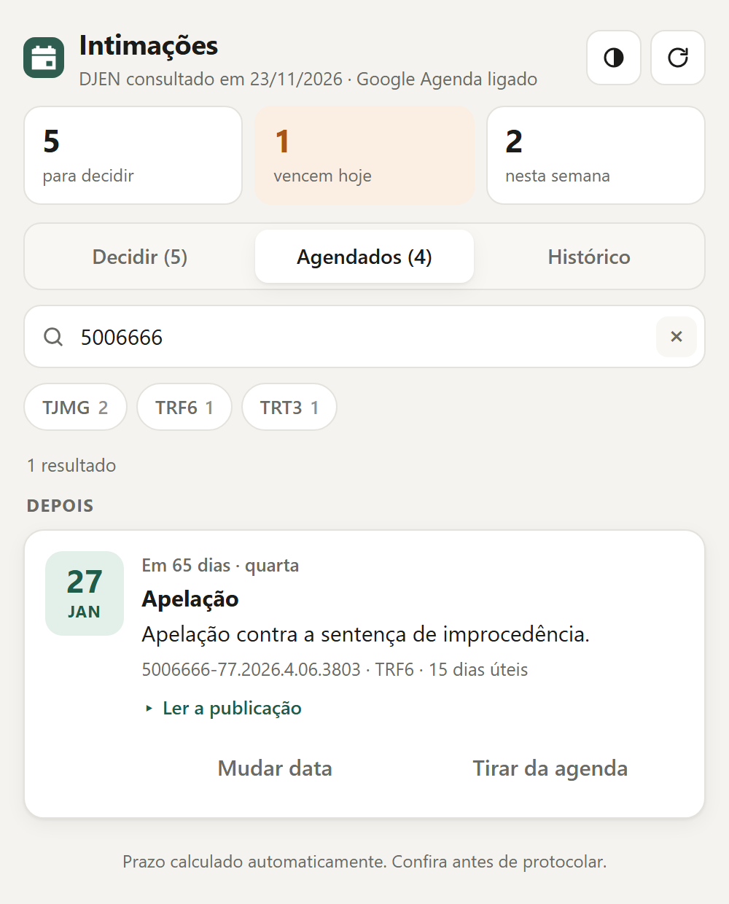
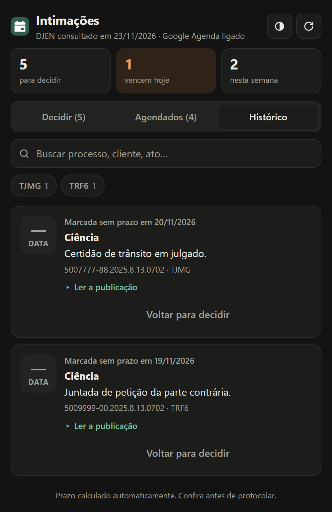

# Intimações DJEN

### Suas intimações do DJEN chegam sozinhas, com o prazo calculado, num painel ao lado do Chrome.

Você abre o navegador de manhã e as publicações do dia já estão lá, com a sugestão de prazo para cada uma. Você confere e agenda com um clique.

&nbsp;&nbsp;&nbsp;

**Assinatura anual por OAB** · Windows + Google Chrome · Criado por [Everton Alves da Silva](https://github.com/evertonalves-ai)

---

## Como fica o seu dia

| Horário | O que acontece |
|---|---|
| **5h da manhã** (você escolhe) | O programa consulta o DJEN pelo seu número de OAB e baixa as publicações novas. |
| **Logo em seguida** | O Claude lê cada uma e **sugere** se exige prazo, qual ato praticar e quantos dias. O vencimento é calculado no calendário do tribunal que publicou. |
| **Quando você abre o Chrome** | O ícone mostra quantas intimações esperam a sua decisão. Você confere, agenda, ajusta a data ou marca como sem prazo. |
| **Ao agendar** | O prazo vai para o seu Google Agenda, com lembrete 2 dias antes. |

## O que você vê no painel

<table>
<tr>
<td width="50%" valign="top">

**Decide com um clique, e pode desfazer**

Cada cartão mostra a data sugerida, quanto falta, o ato e por que o Claude chegou àquela sugestão. Agendou por engano? O aviso embaixo tem "Desfazer".

</td>
<td width="50%" valign="top">

**O urgente primeiro**

Um toque em "Urgentes" deixa só o que vence em poucos dias. Também dá para filtrar por tribunal ou pelas publicações marcadas para conferir.

</td>
</tr>
<tr>
<td width="50%" valign="top">

**Acha qualquer processo**

Digite parte do número, com ou sem pontuação, o nome do cliente, o ato ou uma palavra da publicação.

</td>
<td width="50%" valign="top">

**Nada some sem você ver**

O que você marcou como sem prazo fica no Histórico por 60 dias, com "Voltar para decidir". Tema claro, escuro ou automático.

</td>
</tr>
</table>

As imagens usam dados fictícios.

## Por que dá para confiar no cálculo

- **Regras do CPC e da Lei 11.419/2006.** Publicação no primeiro dia útil após a disponibilização, contagem a partir do dia útil seguinte, só dias úteis, recesso de 20/12 a 20/01 e prazo em dobro quando cabe.
- **Calendário de cada tribunal.** O programa usa os dias sem expediente que o próprio tribunal fixa em portaria, como Cinzas, Semana Santa, Dia do Servidor e feriados transferidos, além dos feriados da sua comarca.
- **Ele avisa quando não sabe.** Se o calendário de um tribunal ainda não foi cadastrado, o cartão diz isso e pede conferência, em vez de chutar.
- **Na dúvida, mais cedo.** Quando o programa fica em dúvida sobre um dia, ele o trata como útil. O vencimento pode sair um dia antes, nunca um dia depois.
- **Nada é descartado sem você.** Toda publicação passa pelo painel, inclusive as que o Claude acha que são só ciência. Quando ele fica em dúvida, explica o motivo no cartão.
- **Prazo em dobro e dias corridos com aviso.** Quando a triagem sugere prazo em dobro, ou contagem em dias corridos (processo penal), o cartão avisa para você conferir.

> A classificação é feita por inteligência artificial e o cálculo é um auxílio. A conferência do prazo antes do protocolo continua sendo do advogado.

## Seus dados ficam no seu computador

O programa roda na sua máquina. As publicações vêm direto do CNJ, a triagem usa a sua própria conta do Claude e o Google Agenda é o seu. Não existe servidor nosso no meio, e nós não vemos os seus processos nem os seus clientes.

## Atualizações automáticas e seguras

Calendários novos dos tribunais e melhorias chegam sozinhos, uma vez por dia. Cada versão é assinada digitalmente, e o programa só instala o que tiver a assinatura conferida.

## Do que você precisa

- Windows 10 ou 11 e Google Chrome
- Assinatura **Claude Pro** com o Claude Code instalado (é ele que lê as publicações)
- Computador ligado no horário da consulta. Se estiver desligado, a consulta roda quando você ligar.

## Assinatura

Licença anual vinculada ao seu número de OAB, com 7 dias para desistir e receber o valor de volta.

**Preço e link de compra: em breve.**

## Perguntas frequentes

**Funciona para qualquer tribunal?**
Funciona para qualquer tribunal que publique no DJEN. O calendário próprio de cada tribunal é cadastrado conforme a portaria anual dele sai. Enquanto isso não acontece, o cartão avisa para conferir.

**Preciso saber mexer em computador?**
Não. Depois de instalado, você só usa o painel do Chrome. A instalação é guiada, passo a passo.

**E se o Claude não responder num dia?**
O programa faz uma triagem por regras, marca tudo para você conferir e, na consulta seguinte, refaz com o Claude.

**Funciona no Mac?**
Por enquanto, só no Windows.

## Download

Clientes recebem a chave de licença por e-mail e baixam a [versão mais recente](../../releases/latest). Depois de instalado, o programa se atualiza sozinho.

---

Software proprietário. © 2026 Everton Alves da Silva. Este repositório distribui apenas os pacotes de instalação. Veja a <a href="LICENSE">licença</a>.

