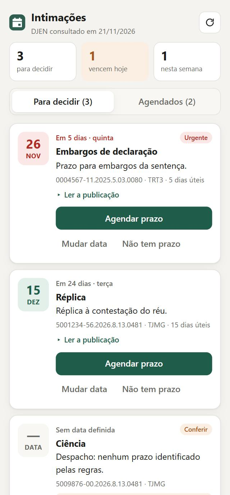
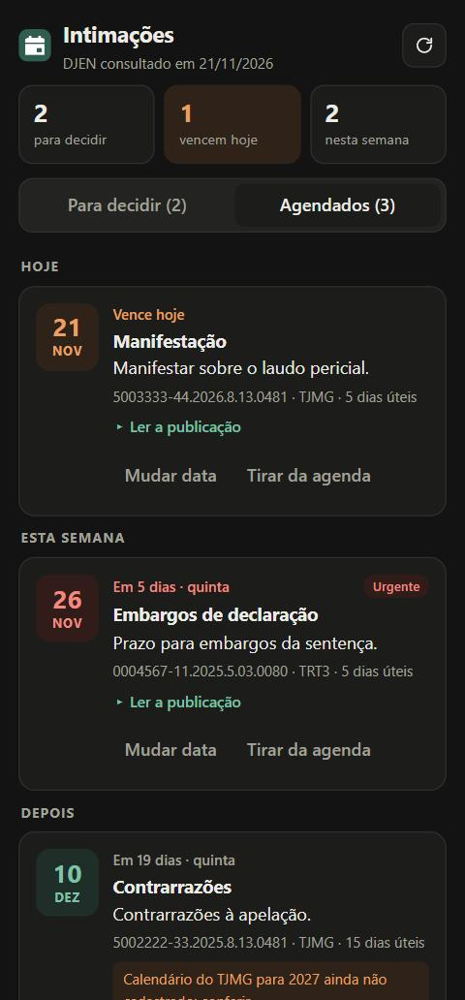

# Intimações DJEN

**As intimações do Diário de Justiça Eletrônico Nacional no seu Chrome, com o prazo calculado e pronto para agendar.**

Criado por **[Everton Alves da Silva](https://github.com/evertonalves-ai)**

&nbsp;&nbsp;

## O que faz

Todo dia, no horário que você escolher, o programa consulta o DJEN do CNJ pelo seu número de OAB. O Claude lê cada publicação e diz se ela exige prazo, qual ato praticar e quantos dias. O vencimento é calculado no calendário do tribunal que publicou: dias úteis, recesso de 20/12 a 20/01, feriados nacionais, estaduais e da sua comarca.

Você decide num painel ao lado do Chrome: **Agendar prazo**, **Mudar data** ou **Não tem prazo**. Com o Google Agenda ligado, o prazo aprovado vai para a sua agenda, com lembrete.

> O prazo é calculado automaticamente e deve ser conferido antes de protocolar.

## Seus dados ficam com você

O programa roda no seu computador. As publicações vêm direto do CNJ e a triagem usa a sua própria conta do Claude. Não existe servidor do desenvolvedor no meio.

## Requisitos

- Windows 10 ou 11 e Google Chrome
- Claude Code com assinatura Claude Pro
- Chave de licença (assinatura anual, vinculada ao número da OAB)

## Instalação e atualizações

Baixe o arquivo `IntimacoesDJEN-<versão>.zip` da [versão mais recente](../../releases/latest), extraia e siga o `COMO INSTALAR.txt`. Depois de instalado, o programa se atualiza sozinho: cada versão é assinada digitalmente e só é instalada se a assinatura conferir.

## Licença

Software proprietário. © 2026 Everton Alves da Silva. O uso exige chave de licença válida. Este repositório distribui apenas os pacotes de instalação.
